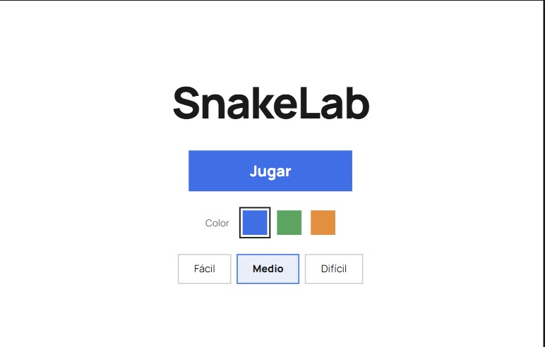
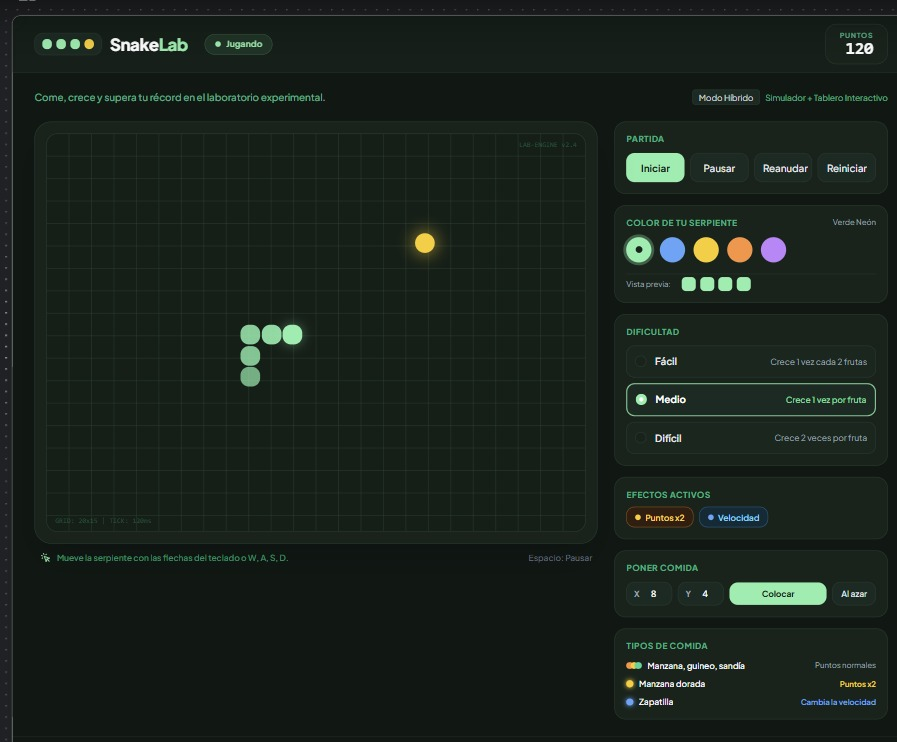

# Practica 2 patrones 

### Estudiantes : Luis Romero, Xavier Aucay

## Mockup Inicial 

# Mockup con ayuda de IA

# Diagrama de clases

## Patron elegido 

Elegimos Factory Method porque nos permite delegar la creación de cada tipo de comida o variante de serpiente a clases creadoras específicas, así no llenamos la lógica del juego ni la interfaz de new o condicionales y podemos añadir nuevos tipos sin tocar el código principal.
